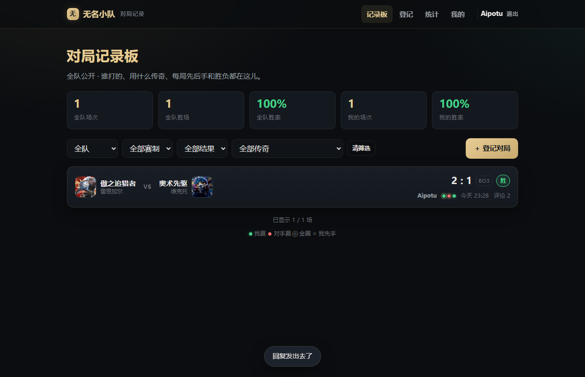

# 麻小尉 · 项目作品集

> 2027 届本科（2027.06 毕业）· 上海第二工业大学 · 数字媒体技术
> 以 **AI Coding 为主要生产方式的独立开发者**：用 AI Agent 把需求一路推到上线——实现、自动化测试、云部署与失败回滚全程自闭环。

---

## 项目一览

| 项目 | 形态 | 状态 | 技术栈 |
|---|---|---|---|
| [竞技场酒吧](projects/arena-bar.md) | TCG 赛事 / 天梯 / 工具平台 | **线上运行** | Node.js 22 · node:sqlite · 零构建前端 · nginx / systemd |
| [凌泉](projects/lingquan.md) | 长期自主运行的 AI Agent | **长期运行** | LLM Agent · 四层记忆 · 工具调用 · systemd / timers |
| [星骸残响](projects/star-echo.md) | Unity 2D 肉鸽卡牌 + 网页版 | **网页版已上线** | Unity C# · 程序化美术 · SDXL / Flux · Cloudflare Pages |
| 无名小队 | 队内对局记录板 | 线上运行 | Node.js · SQLite · PWA · 四层测试 |

## 线上 Demo

| 项目 | 地址 | 说明 |
|---|---|---|
| 《星骸残响》网页版 | https://star-echo.pages.dev | 手机浏览器可玩，无需安装 |
| 竞技场酒吧 | http://106.14.24.65:8787/ | 符文战场 TCG 玩家工具箱与天梯 |
| 无名小队 | https://106.14.24.65/ | 队内对局记录板，演示口令 `wumingxiaodui` |

## 截图

| 星骸残响 · 选角 | 竞技场酒吧 | 无名小队 |
|---|---|---|
|  |  |  |

---

## 我在这些项目里做的事

一个人从需求、数据、后端、前端写到线上部署与运维；AI 负责实现速度，我负责**定义问题、设验收标准、兜线上风险**。

三个项目都不是玩具：

- 竞技场酒吧承载 **1500+ 卡牌 / 3400+ 规则条目**，有真实玩家在用，配套 **42 个测试文件**与可回滚发布
- 凌泉是**长期自主运行**的 Agent，四层记忆跨会话保持一致，带一套「自测反向验证记忆」的闭环
- 星骸残响是完整游戏循环（地图 → 战斗 → 奖励 → Boss → 胜负）的 2D 肉鸽卡牌，并已发布网页版

## 工程方法

1. **契约先行**：先固定 schema、接口语义与状态机，业务规则先写成测试、先跑红再实现
2. **测试分层**：单元测业务规则 / e2e 验接口契约 / 真浏览器验交互 / 线上只读冒烟验部署
3. **可回滚发布**：白名单打包 → sha256 校验 → 原子切换 → 健康检查 → 失败自动回滚

## 说明

- **源码不开源**：项目含私有数据与服务器配置，本仓库只放项目说明、架构与截图。
- 想深入聊某一块（记忆系统的评测闭环、天梯的匹配算法、程序化美术管线），欢迎直接联系。
