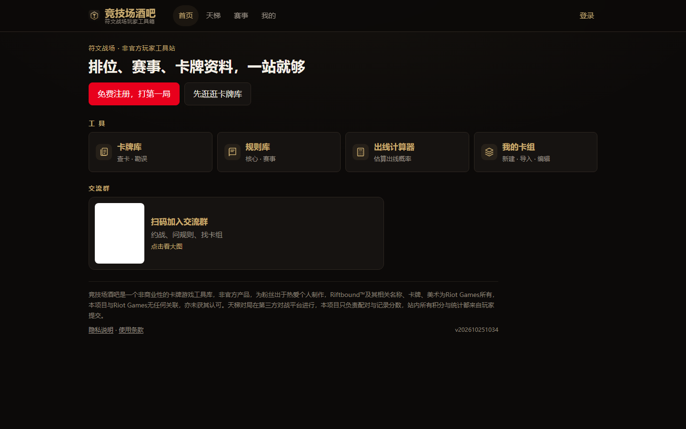
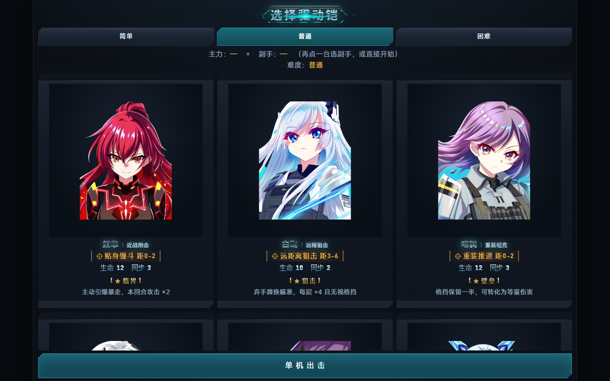

# 麻小尉 · 项目作品集

> 2027 届本科（2027.06 毕业）· 上海第二工业大学 · 数字媒体技术
> **TCG 生态实践者 + 能把产品做出来的开发者**：从数据、后端、前端写到线上部署与运维。

---

## 项目一览

| 项目 | 形态 | 状态 | 技术栈 |
|---|---|---|---|
| [竞技场酒吧](projects/arena-bar.md) | TCG 赛事 / 天梯 / 数据平台 | **线上运行** | Node.js 22 · node:sqlite · 零构建前端 · nginx / systemd |
| [星骸残响](projects/star-echo.md) | Unity 2D 肉鸽卡牌 + 网页版 | **网页版已上线** | Unity C# · 程序化美术 · SDXL / Flux · Cloudflare Pages |

## 线上 Demo

| 项目 | 地址 | 说明 |
|---|---|---|
| 竞技场酒吧 | http://106.14.24.65:8787/ | 《符文战场》TCG 玩家工具箱与天梯 |
| 《星骸残响》网页版 | https://star-echo.pages.dev | 手机浏览器可玩，无需安装 |

## 截图

| 竞技场酒吧 · TCG 天梯与工具 | 星骸残响 · 驱动铠选择 |
|---|---|
|  |  |

---

## 我在这些项目里做的事

一个人从需求、数据、后端、前端写到线上部署与运维；AI 负责实现速度，我负责**定义问题、设验收标准、兜线上风险**。

两个项目都不是玩具：

- **竞技场酒吧**承载 **1,506 张卡牌 / 3,469 条规则 / 58 位传奇**，有真实玩家在用，配套 **73 个测试文件**与可回滚发布
- **星骸残响**是完整游戏循环（地图 → 战斗 → 奖励 → Boss → 胜负）的 2D 肉鸽卡牌，核心是原创的「同步率 / 暴走」资源机制，并已发布网页版

## 工程方法

1. **契约先行**：先固定 schema、接口语义与状态机，业务规则先写成测试、先跑红再实现
2. **测试分层**：单元测业务规则 / e2e 验接口契约 / 真浏览器验交互 / 线上只读冒烟验部署
3. **可回滚发布**：白名单打包 → sha256 校验 → 原子切换 → 健康检查 → 失败自动回滚

## 说明

- **源码不开源**：项目含私有数据与服务器配置，本仓库只放项目说明、架构与截图。
- 想深入聊某一块（天梯的匹配算法、卡池数据的完整性校验、程序化美术管线），欢迎直接联系。
