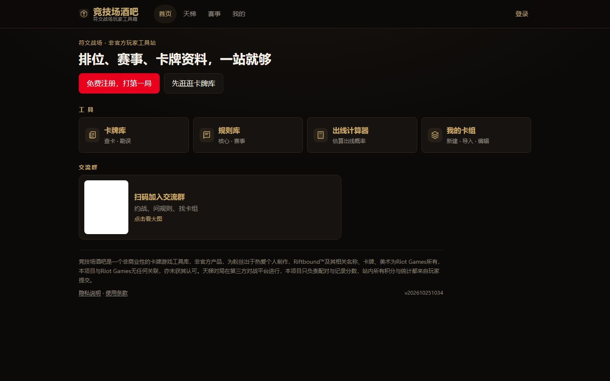

# 竞技场酒吧 · TCG 赛事与天梯平台

> 线上：http://106.14.24.65:8787/
> 状态：**线上运行**，服务真实玩家

## 它是什么

《符文战场》（Riftbound）玩家的工具箱与赛事平台：天梯排位、赛事记录、卡牌与规则数据、瑞士轮出线概率计算器、移动端 PWA。

单一个人项目——没有团队、没有排期，数据、后端、前端、部署都由我完成。

## 技术栈

| 层 | 选型 | 为什么 |
|---|---|---|
| 服务端 | Node.js 22 **零依赖**（内置 `http`） | 部署体积小、无供应链风险 |
| 数据库 | `node:sqlite` | 单文件、零运维、够用 |
| 前端 | 原生 ES Module，**零构建** | 改完刷新就生效，没有打包步骤 |
| 部署 | nginx + systemd + HTTPS | 真机运维，发布可回滚 |

## 关键实现

### 1. 分数制天梯

- 起始 1500 分，单局变化 `±50 × factor`
- **动态匹配窗口**：起始 ±100，每分钟 +50，封顶 700
- **BO1 / BO3 双天梯**：两套分与两套匹配池
- 对局生命周期：排队 → 匹配 → 对局 → 结算 → 申诉/异常处理

### 2. 数据底座

- 1506 张卡牌 / 3469 条规则 / 58 位传奇
- 同步脚本按顺序跑，DB 写入与 schema 迁移分离
- 完整性检查（缺卡、孤儿规则、传奇引用）

### 3. 工程化

- **42 个测试文件**：评分、匹配窗口、对局状态机、限流、schema 校验、e2e
- 发布脚本：白名单打包 → 上传 → **sha256 校验** → **原子切换 `current` 软链** → 重启 → 健康检查 → **失败自动回滚**
- 接口限流防刷、PWA 离线缓存

## 结果

- 线上长期运行在 2C/2G 云服务器上
- 天梯与赛事有真实玩家使用
- 一次改坏可以 30 秒内回滚，不需要人肉救火

## 和 AI 的协作方式

AI 写实现，我做三件事：定 schema 与状态机、判断测试断言是否真是业务、兜线上风险。AI 最常犯的错是「看着对、边界错」——平局、重复提交、BO3 提前结束、断线重连，全靠测试与线上冒烟抓出来。

