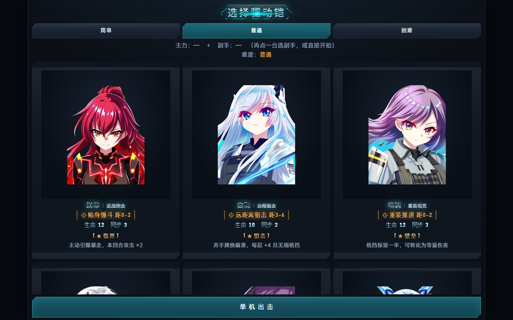

# 星骸残响 · 2D 肉鸽卡牌

> 网页版（手机可玩）：https://star-echo.pages.dev
> 形态：Unity 桌面 demo + 网页版已上线
> 题材：科幻机娘 · 2D 肉鸽卡牌 · 小体量精品

## 它是什么

玩家扮演「整备师」，带 2 台驱动铠闯关。核心是一套原创资源机制——**同步率 / 暴走**：同步率越高伤害越高，但会失控。

一句话卖点：**用会暴走的驱动铠打牌。**

## 完整游戏循环

```
标题 → 地图选节点（战斗 / 精英 / 篝火 / BOSS）
     → 回合制卡牌战斗
     → 奖励选牌
     → 下一关 → …… → Boss 战 → 胜负
```

全部状态机与异步战斗流程自己写（`Title / Map / Combat / Reward / Victory / Defeat`）。

## 核心机制：同步率 / 暴走

| 区间 | 状态 | 效果 |
|---|---|---|
| 0~30 | 低同步 | 伤害 −20%，免疫暴走 |
| 31~70 | 正常 | 基准 |
| 71~100 | 高同步（预警） | 伤害 +30%，下一次 +同步 必触发暴走 |
| ≥100 | 暴走 | 伤害 +50%，持续 2 回合，优先攻击威胁最高的敌方 |

设计意图：每张强卡都写着「用我，可能暴走哦」——玩家永远在火力与稳定之间走钢丝。暴走由可控的同步率精确决定，不是掷骰子。

## 系统

- **卡牌系统**：抽牌堆 / 手牌 / 弃牌堆，费用、目标、效果
- **敌人意图 AI**：提前显示意图，玩家据此决策
- **状态效果**：力量 / 易伤 / 中毒
- **表现层**：回合横幅、飞牌悬停、敌方技能卡、漂浮伤害数字、冲击波、全屏闪红、屏幕震动

## 美术：全程序化 + AI 出图

- **程序化生成**：卡面、敌人立绘、卡框、面板、按钮、血条、地图图标——全部代码绘制，**零外部美术资源**
- **AI 出图管线**：SDXL / Flux 生成卡面与角色立绘，参数扫描 + 指标评测，逐步替换程序化美术
- 视觉风格：赛博霓虹像素 → 机娘立绘

## 双形态交付

| 形态 | 状态 | 说明 |
|---|---|---|
| Unity 桌面版 | demo（Steam 方向） | 完整循环可玩 |
| 网页版 | **已上线** | Cloudflare Pages，手机浏览器直接玩 |

## 技术栈

Unity C# · uGUI 程序化 UI · 自写状态机 · 像素美术生成 · SDXL / Flux / ComfyUI · Cloudflare Pages


